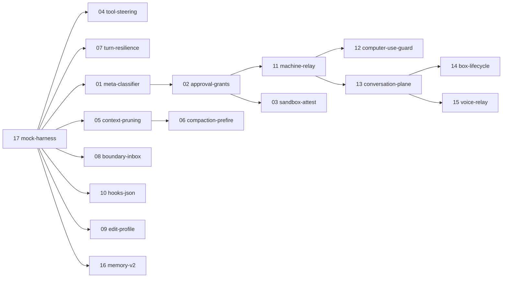

# Plans

These plans cover capabilities that are not built yet. Each one comes from three reverse-engineering sources:

- **Grok Bot**: Anysphere/xAI desktop agent. Evidence in `~/projects/grokbot-re/re/`.
- **droid**: Factory CLI, with its original TypeScript source recovered. Evidence in `/var/lib/hermes/projects/droid/notes/`.
- **Grok Build**: xAI's open-source harness. Source at `~/projects/grokbot-re/artifacts/grok-build/`.

Every plan follows the house posture in `../../README.md`:

- explicit beats implicit;
- verdicts are bound to evidence;
- anything that changes behaviour runs in shadow before it is applied;
- native stores stay authoritative.

A plan proposes a host seam only when no existing `VALID_HOOKS` hook or middleware kind can do the job. Host seams are small and named so they can be upstreamed. Their fire-sites live in `~/projects/hermes-agent`.

Every plan has the same sections: Goal, Evidence, Current state, Design, Host changes, Phases with acceptance checks, Tests, Risks & open questions, and Non-goals. All plans are **proposed**; none is approved yet.

## Index

| # | Plan | Area | Shape | Depends on |
|---|---|---|---|---|
| 01 | [meta-classifier](01-meta-classifier.md) | Safety | Plugin. Finishes the untracked `plugins/meta-classifier/` work: classifier label sets derived from droid, a shadow check of the model's declared risk, and false-positive labels | — |
| 02 | [approval-grants](02-approval-grants.md) | Safety | Plugin plus a small approval seam. Approvals become data: bound to an id, retirable, with a TTL, standing grants, and denylists that fail closed | — |
| 03 | [sandbox-attest](03-sandbox-attest.md) | Safety | Host or terminal backend. A sandbox that proves itself before running work, using canaries, a network probe and a config hash | — |
| 04 | [tool-steering](04-tool-steering.md) | Loop | Plugin, plus optional seam H1 for P2. Every tool refusal or failure tells the model what happened, whether to retry, the sanctioned alternative, and whom to ask | coordinates with loop-guard and auto-review |
| 05 | [context-pruning](05-context-pruning.md) | Context | Plugin using the `llm_request` middleware kind. Prunes tool results by age, cache-safe | optional H2 |
| 06 | [compaction-prefire](06-compaction-prefire.md) | Context | Host seam H3 plus plugin. Computes the summary in the background before it is needed, then re-injects key context after compaction | 05, 07 (related) |
| 07 | [turn-resilience](07-turn-resilience.md) | Loop | Observer for P0, stream seam for P1. Catches degenerate output within a single response and gives each failure class its own retry budget | boundary with loop-guard |
| 08 | [boundary-inbox](08-boundary-inbox.md) | Orchestration | Host seams. Generalises the `/steer` drain into a typed inbox covering user, inter-agent and subagent-completion messages, plus wake turns and `resume_from` | 04, 11 (coordinates) |
| 09 | [edit-profile](09-edit-profile.md) | Tools | Host refactor. One resolver decides the edit format per model family, with an `agent.edit_profile` override | — |
| 10 | [hooks-json](10-hooks-json.md) | Extensibility | Plugin plus a `pre_stop` seam. Compatibility with Claude Code and Cursor `hooks.json` files | — |
| 11 | [machine-relay](11-machine-relay.md) | Distributed | Plugin plus a `hermes-machine` daemon. Agents reach the user's machine through an outbound-only relay | 02; 12 for P4 |
| 12 | [computer-use-guard](12-computer-use-guard.md) | Safety | Hardening of `tools/computer_use/`: app deny policy, stable target ids, capture size caps | 02; 11 for the relay path |
| 13 | [conversation-plane](13-conversation-plane.md) | Distributed | Host seams H1–H4 plus plugin. Idempotent sends, a transcript watch stream with resumable cursors, live state, and lean tool-call entries | 14, 15 (complements) |
| 14 | [box-lifecycle](14-box-lifecycle.md) | Distributed | Host seams plus plugin. A shared box lifecycle: describe, ensure, snapshot and recreate, with consent required before any data loss | 13 |
| 15 | [voice-relay](15-voice-relay.md) | Surfaces | Host seams plus plugin. The voice agent hands work off and gets a receipt; results arrive as evidence; it can stay silent | 13 |
| 16 | [memory-v2](16-memory-v2.md) | Memory | Memory-provider plugin. Typed observations go to an inbox, a shadow-first Dream pass consolidates them, and a bounded index is injected | 17 (tests) |
| 17 | [mock-harness](17-mock-harness.md) | QA | `mockmodel/`. A scripted model server for 3 wire formats, with fault injection, an egress tripwire, and a smoke script | — |

## Classifier plans (18–32)

Each one starts in shadow, collects labels through replay, and acts only after its promotion gate. All share plan 01's classifier client and label store.

| # | Plan | Labels | Feeds |
|---|---|---|---|
| 18 | [turn-outcome](18-turn-outcome-classifier.md) | done / blocked-needs-user / gave-up / claims-done-without-evidence / mid-task | `continuation` finish gate |
| 19 | [queued-message-intent](19-queued-message-intent-classifier.md) | steer / interrupt / append-to-queue / unrelated-new-task | 08 boundary-inbox, `/steer` |
| 20 | [tool-failure](20-tool-failure-classifier.md) | transient / env-missing / permission / bad-args / model-misuse / real-bug | 04 steering, 07 retry budgets, loop-guard |
| 21 | [compaction-keepset](21-compaction-keepset-classifier.md) | decision / constraint / user-preference / dead-end / noise | 06 compaction summary |
| 22 | [memory-worthiness](22-memory-worthiness-classifier.md) | durable-fact / preference / procedure / ephemeral / secret | 16 memory-v2 capture gate |
| 23 | [outbound-content](23-outbound-content-classifier.md) | contains-secret / PII / internal-only / ok | anything sent off the machine |
| 24 | [recipient-novelty](24-recipient-novelty-classifier.md) | seen-before / new-recipient / new-app / new-domain | 02 standing grants |
| 25 | [prompt-injection](25-prompt-injection-classifier.md) | instruction-like / benign | tool results (web, files, MCP) |
| 26 | [screen-state](26-screen-state-classifier.md) | login-or-password / payment / destructive-dialog / system-settings / normal | 12 computer-use-guard |
| 27 | [task-routing](27-task-routing-classifier.md) | trivial / standard / deep-reasoning / long-context / vision | `model-routing`, `prewalk` |
| 28 | [delegation-fit](28-delegation-fit-classifier.md) | do-inline / delegate-parallel / delegate-background / needs-user | delegation, `subagent-effort` |
| 29 | [machine-target](29-machine-target-classifier.md) | box / user-laptop / either | 11 machine-relay, 14 box-lifecycle |
| 30 | [voice-speak](30-voice-speak-classifier.md) | speak-now / stay-silent / defer-until-pause | 15 voice-relay |
| 31 | [chat-addressing](31-chat-addressing-classifier.md) | addressed-to-bot / ambient / reply-to-other-human | gateway admission, hosted rooms, Bot Mode |
| 32 | [notification-urgency](32-notification-urgency-classifier.md) | interrupt / digest / drop | cron, background tasks, Bot Mode delivery |

Suggested first three: 18, 25 and 19. Each feeds a decision that already exists, and a wrong answer there costs something concrete.

## Suggested order

1. **Foundation:** 17. Every later plan's acceptance checks run on it.
2. **Cheap wins with no host seams:** 04, 05, 07 P0, 01, 16, 10 P0.
3. **Small host seams:** 06, 08, 09, 02.
4. **Distributed, Grok Bot–shaped work:** 11 → 12, then 13 → 14 and 15, then 03.

## Already covered (not re-planned)

These capabilities already exist, so no plan repeats them:

- Deferred tool catalog: native `tool_search`.
- Explicit model and role routing: `model-routing`.
- Planner-to-executor handoff: `prewalk`.
- Evidence-bound completion: `continuation`.
- Tool-call loop detection: `loop-guard`.
- Scoped rules: `rules`.
- Browser backend: `browser-bladebro`.
- Durable worklists: `covey-tasks`.
- Effort shadowing: `subagent-effort`.
- Hosted rooms, Bot Mode, cron, A2A and MCP OAuth: Hermes core.
